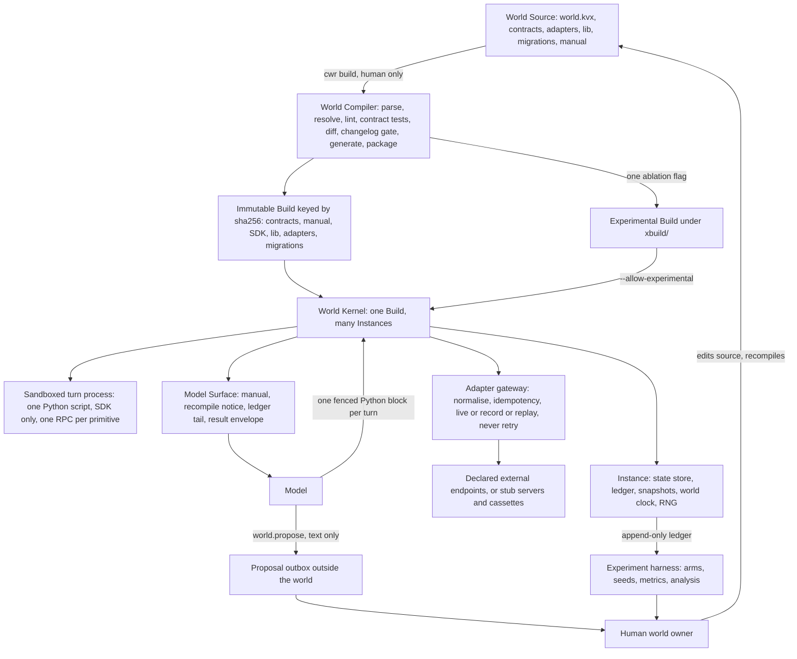

# Compiled World Runtime

Status: CWR is in development and has no release. One of the twenty qualification cases that decide
whether it meets its specification has passed; see [Status](#status).

The Compiled World Runtime (CWR) is a runtime in which an AI model acts by running scripts inside a
compiled, rule-governed world. A human writes the rules as World Source. The World Compiler turns
that source into an immutable Build. The World Kernel runs Instances of the Build, executes one
sandboxed script per turn, records every action in a ledger and mediates every call to an outside
service. The rules change only when a human recompiles.

## What CWR guarantees

| Guarantee | What it means |
|---|---|
| Closure | A turn script reaches nothing but the SDK generated for its Build: no network, no filesystem outside its scratch directory, no wall clock. |
| Predictable failure | Every call either succeeds or fails with one of eleven failure envelope codes, and the outcome depends only on conditions the model can query. |
| One contract | The manual the model reads, the SDK it calls and the table the kernel enforces are generated from one compiled contract, so documentation and enforcement cannot diverge. |
| Immutability | A Build is content-addressed. Any change to its bytes changes its identity, and the kernel refuses a Build whose bytes do not match its hash. |
| Ledger integrity | The ledger is append-only and hash-chained. Replaying it with recorded adapter responses reproduces the same state, and the kernel refuses a tampered ledger. |
| Mediated side effects | Every external call passes through the adapter gateway. Failures map to declared codes, idempotency keys prevent duplicate side effects, and nothing is retried silently. |
| Controlled change | A rule changes only through a human recompilation with a changelog and a version bump. An Instance moves to the new Build only by an explicit upgrade, and the model receives a recompile notice. |

## Three pillars

| Pillar | Commitment |
|---|---|
| Stability | Rules are fixed for the life of a Build. The same action under the same visible conditions yields the same outcome. |
| Direct action | The world's primitives are native to the script, so one script replaces a long chain of separate tool calls. |
| Controlled change | Only a human recompiles. Every Build is versioned, and every change is documented and announced to the model. |

The project tests four hypotheses: H1 Stability, H2 Direct action, H3 Long context and H4 Controlled
change. Every experimental arm is a CWR Build with one pillar removed. CWR is not compared with any
other system.

## Architecture

A human edits World Source and runs the World Compiler, which checks it and packages a Build. The
World Kernel runs many Instances of one Build. Each turn the model reads the Model Surface (the
manual, the recompile notice, the ledger tail and the last result envelope) and answers with one
Python script. The kernel runs that script in a sandbox, where each world call is an atomic
primitive. Calls to outside services pass through the adapter gateway. A model that wants a rule
changed can only write to the proposal outbox, which the human world owner reads.



The diagram is adapted from [spec/cwr/diagrams/architecture.mmd](spec/cwr/diagrams/architecture.mmd).
A single turn is drawn in [spec/cwr/diagrams/turn.mmd](spec/cwr/diagrams/turn.mmd).

## Quick start

CWR runs on Linux. It needs:

| Requirement | Used for |
|---|---|
| Rust toolchain with `cargo` | Building the `cwr` binary |
| Python 3.12 as `python3.12` | Turn scripts, world library code and repository tooling |
| bubblewrap as `bwrap` | The turn sandbox. The kernel refuses to run a script without it. |

Build the `cwr` binary and put it on your path:

```sh
make build
export PATH="$PWD/target/release:$PATH"
```

Check and compile the reference world, `refworld`:

```sh
cwr lint examples/refworld
cwr build examples/refworld
```

`cwr build` runs eight stages: parse, resolve, lint, contract tests, diff, changelog gate, generate
and package. It writes the Build under `build/` and prints its hash as `built sha256:<hex> at
<path>`. Use that hash in the commands below.

Read the manual the model will see, then create an Instance. `cwr instance create` prints the new
Instance id. Instances live under `.cwr/` in the working directory unless `--home` or `CWR_HOME`
names another location.

```sh
cwr manual sha256:<hex>
cwr instance create sha256:<hex> --seed 7
```

Run one turn. The script arrives on standard input, exactly as a model would send it:

```sh
cwr instance turn <id> <<'EOF'
import fs

fs.write(path="/notes/hello.md", content=b"hello")
return fs.exists(path="/notes/hello.md")
