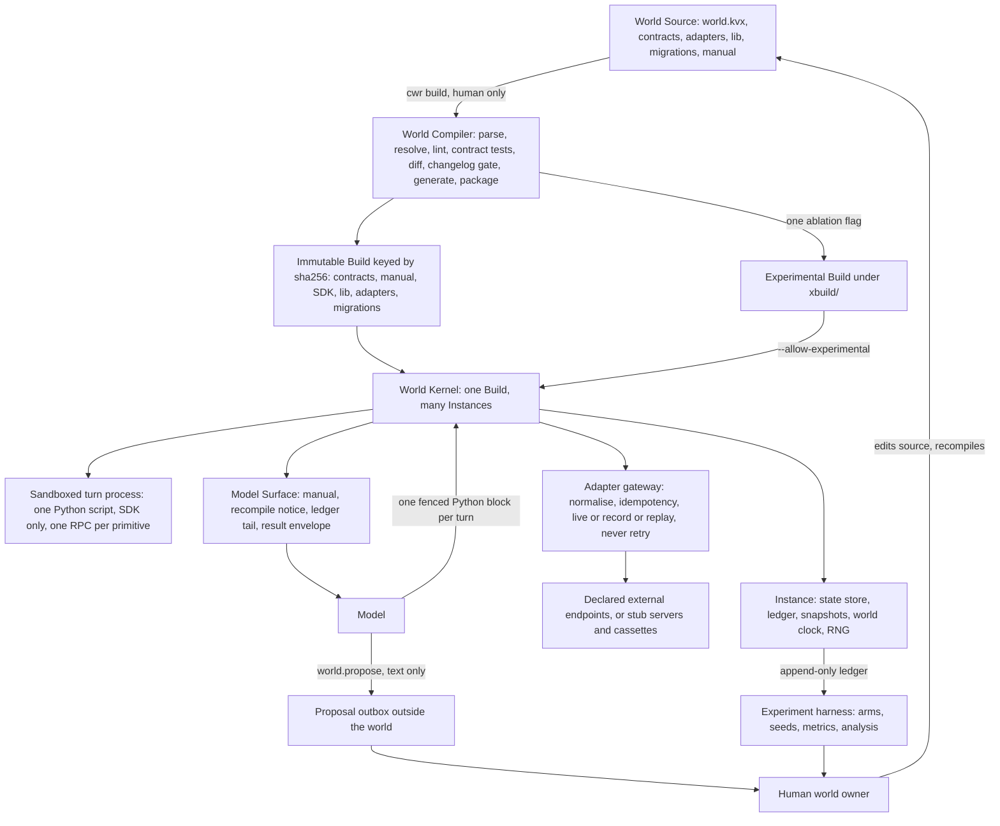

<!-- Copyright Sidiora Labs Inc. CWR® 2026-2027 -->
<!-- SPDX-License-Identifier: LicenseRef-Sidiora-DEV-OSS-1.0 -->

# Compiled World Runtime

> **Implemented, not yet qualified (CWR-020).** CWR is in development: it has no release and has not yet passed qualification; see [Status](#status). This document describes the shipped [`cwr` binary](crates/cwr-cli/src/main.rs).

The Compiled World Runtime (CWR) is a runtime in which an AI model acts by running scripts inside a
compiled, rule-governed world. A human writes the rules as World Source. The World Compiler turns
that source into an immutable Build. The World Kernel runs Instances of the Build, executes one
sandboxed script per turn, records every action in a ledger and mediates every call to an outside
service. The rules change only when a human recompiles.

## What CWR guarantees

| Guarantee | What it means |
|---|---|
| Closure | A turn script reaches nothing but the SDK generated for its Build: no network, no filesystem outside its scratch directory, no wall clock. |
| Predictable failure | Every call either succeeds or fails with one of eleven failure envelope codes, and the outcome depends only on conditions the model can query. |
| One contract | The manual the model reads, the SDK it calls and the table the kernel enforces are generated from one compiled contract, so documentation and enforcement cannot diverge. |
| Immutability | A Build is content-addressed. Any change to its bytes changes its identity, and the kernel refuses a Build whose bytes do not match its hash. |
| Ledger integrity | The ledger is append-only and hash-chained. The kernel refuses a truncated ledger and any edit made without recomputing the chain. The chain is unkeyed, so file permissions must protect the Instance store from re-chained edits. Replaying the ledger with recorded adapter responses, upgrades and restores included, reproduces the same state, and a re-chained edit does not survive replay. Replay refuses a ledger in which a kernel crash interrupted a turn. |
| Mediated side effects | Every external call passes through the adapter gateway. Failures map to declared codes, idempotency keys prevent duplicate side effects, and nothing is retried silently. |
| Controlled change | A rule changes only through a human recompilation with a changelog and a version bump. An Instance moves to the new Build only by an explicit upgrade, and the model receives a recompile notice. |

## Three pillars

| Pillar | Commitment |
|---|---|
| Stability | Rules are fixed for the life of a Build. The same action under the same visible conditions yields the same outcome. |
| Direct action | The world's primitives are native to the script, so one script replaces a long chain of separate tool calls. |
| Controlled change | Only a human recompiles. Every Build is versioned, and every change is documented and announced to the model. |

The project tests four hypotheses: H1 Stability, H2 Direct action, H3 Long context and H4 Controlled
change. Every experimental arm is a CWR Build with one pillar removed. CWR is not compared with any
other system.

## Architecture

A human edits World Source and runs the World Compiler, which checks it and packages a Build. The
World Kernel runs many Instances of one Build. Each turn the model reads the Model Surface (the
manual, the recompile notice, the ledger tail and the last result envelope) and answers with one
Python script. The kernel runs that script in a sandbox, where each world call is an atomic
primitive. Calls to outside services pass through the adapter gateway. A model that wants a rule
changed can only write to the proposal outbox, which the human world owner reads.



The diagram is adapted from [spec/cwr/diagrams/architecture.mmd](spec/cwr/diagrams/architecture.mmd).
A single turn is drawn in [spec/cwr/diagrams/turn.mmd](spec/cwr/diagrams/turn.mmd).

## Install

CWR runs on Linux. It needs:

| Requirement | Used for |
|---|---|
| Python 3.12 as `python3` and `python3.12` | Turn scripts, world library code and repository tooling |
| bubblewrap as `bwrap` | The turn sandbox. The kernel refuses to run a script without it. |
| Rust toolchain with `cargo`, `rustfmt` and `clippy` | Building from source and producing a release bundle |
| `ruff` | Producing a release bundle. The bundler refuses to run without every tool `make check` uses. |

CWR ships as a source bundle, `cwr-<version>.tar.gz`, with its digest in
`cwr-<version>.tar.gz.sha256`. The bundle holds the sources, the prebuilt `cwr` binary as
`bin/cwr` and a `MANIFEST.sha256` with the digest of every file.

No bundle has been published yet. To produce one, run these commands in the root of a repository
checkout. They build the binary and write both files into `../cwr-dist`:

```bash
cargo build --release --locked -p cwr-cli
python3 tools/release.py --output ../cwr-dist
```

From the directory that holds the two files, verify the bundle, unpack it and install the binary:

```sh
sha256sum -c cwr-0.1.0.tar.gz.sha256
tar -xzf cwr-0.1.0.tar.gz
cd cwr-0.1.0
sha256sum --quiet -c MANIFEST.sha256
install -D -m 0755 bin/cwr "$HOME/.local/bin/cwr"
export PATH="$HOME/.local/bin:$PATH"
cwr help
```

Turn scripts need no separate SDK. Every Build carries its own generated SDK, and the sandbox makes
only that SDK importable.

## Quick start

From the unpacked bundle, check and compile the reference world, `refworld`. `cwr build` runs eight stages: parse, resolve, lint, contract tests, diff, changelog gate, generate and package. It writes the Build under `build/`, prints `built sha256:<hex> at <path>`, and `--json` prints the same report as JSON. Building an unchanged source again is "already built", so the second command only reads the hash:

```sh
cwr lint examples/refworld
cwr build examples/refworld
BUILD=$(cwr build examples/refworld --json | python3 -c 'import json, sys; print(json.load(sys.stdin)["build"]["hash"])')
```

When `build/` already holds an earlier Build of the same world, the changelog gate compares the two, and a changed world must carry a new version and a changelog entry. Read the manual the model sees, then create an Instance. `cwr instance create` prints the new Instance id. Instances live under `.cwr/` in the working directory unless `--home` or `CWR_HOME` names another location.

```sh
cwr manual "$BUILD" > manual.md
ID=$(cwr instance create "$BUILD" --seed 7)
```

Run one turn. The script arrives on standard input:

```sh
cwr instance turn "$ID" <<'SCRIPT'
import fs

fs.write(path="/notes/hello.md", content=b"hello")
return fs.exists(path="/notes/hello.md")
SCRIPT
```

The kernel prints the result envelope as JSON: the turn status, a trace of every primitive call and the resources used. Inspect what was recorded:

```sh
cwr instance tail "$ID"
cwr instance ledger "$ID"
```

`cwr instance tail` prints the ledger tail the model sees on its next turn. `cwr instance ledger` verifies the ledger's sequence numbers and hash chain. `cwr help` lists every subcommand, and `cwr instance` with no command lists every Instance command; the guides below give every option and exit code.

## Build from source

Build the workspace in release mode with the dependency versions recorded in
[Cargo.lock](Cargo.lock):

```sh
cargo build --workspace --release --locked
"${CARGO_TARGET_DIR:-target}/release/cwr" help
```

`make build` runs the same build without `--locked`.

## Documentation

| Reader | Start here |
|---|---|
| World author | [docs/cwr/world-source.md](docs/cwr/world-source.md): source layout, contracts, preconditions, the failure envelope, adapters, changelogs, migrations, building |
| Operator | [docs/cwr/kernel.md](docs/cwr/kernel.md): Instances, turns, sandbox limits, the adapter gateway, the ledger, snapshots, replay, upgrades |
| Experimenter | [docs/cwr/experiments.md](docs/cwr/experiments.md): hypotheses, arms, pre-registration, metrics, analysis |
| Reviewer | [spec/cwr/README.md](spec/cwr/README.md): the normative specification and its reading order |
| Contributor | [CONTRIBUTING.md](CONTRIBUTING.md) and [GOVERNANCE.md](GOVERNANCE.md) |
| Security researcher | [SECURITY.md](SECURITY.md) |

The specification, [spec/cwr/spec.kvx](spec/cwr/spec.kvx), is normative. Where a guide and the
specification disagree, the specification wins.

## Repository layout

| Path | Contents |
|---|---|
| `spec/cwr/` | Normative specification: requirements, contract chapters, decisions, diagrams and the specification validator |
| `crates/` | Rust workspace: `cwr-contract` (contract model and failure envelope), `cwr-compiler` (World Compiler), `cwr-kernel` (World Kernel), `cwr-cli` (the `cwr` binary) |
| `sdk/python/` | Runtime and templates for the Python SDK generated into each Build |
| `examples/` | The `refworld` reference World Source and the upgrade pairs U1 to U6 derived from it |
| `modules/` | Reusable World Source module packs |
| `benchmark/` | Task suite, predicates, adapter stub servers, cassettes, experiment harness, campaigns, analysis and release pins |
| `tests/cwr/` | Qualification runner, independent evidence checker, per-task drivers and the evidence registry |
| `docs/cwr/` | Guides for world authors, operators and experimenters |
| `core/` | Shared Python reference code: the KVX reader and the failure envelope |
| `tools/` | Repository tooling: source headers, code map and release checks |
| `research/` | One report per hypothesis, H1 to H4 |
| `scripts/` | Operator scripts: host setup, campaigns and release |
| `vendor/` | Target of `make vendor`. Builds read it only after the source replacement in [vendor/README.md](vendor/README.md) is added. |
| `artifacts/` | Release bundles written by `make release` |

## Status

CWR has no release. A claim about its behaviour counts only when a qualification case backs it.
The specification defines twenty cases, CWR-001 to CWR-020. The runner `tests/cwr/qualify.py`
executes a case. Its outcome enters the evidence registry,
[tests/cwr/registry.kvx](tests/cwr/registry.kvx), only after the independent checker
`tests/cwr/check_evidence.py` accepts the attempt. A release needs an accepted, passing attempt for
every case and the owner's acceptance. No hypothesis has a result yet.

Read the recorded outcome of any case with:

```sh
python3 tests/cwr/check_evidence.py --status CWR-019 || echo "CWR-019 has no accepted attempt: exit $?"
```

The checker prints the derived status of the case, its deciding record and every stale or rejected
record as JSON. It exits 0 when it derives the status from an intact registry and a current
record, and 1 when the deciding record is stale or the evidence store is damaged.

How a release is cut and what it must contain is in [RELEASE.md](RELEASE.md). Changes are recorded
in [CHANGELOG.md](CHANGELOG.md).

## License

CWR is licensed under Sidiora DEV OSS-1.0 (`LicenseRef-Sidiora-DEV-OSS-1.0`). It permits
noncommercial use and converts automatically to the MIT License on the first stable release
designated 1.0.0 or higher. The full text is in [LICENSE](LICENSE), and third-party notices are in
[NOTICE](NOTICE). To cite CWR, use [CITATION.cff](CITATION.cff).
