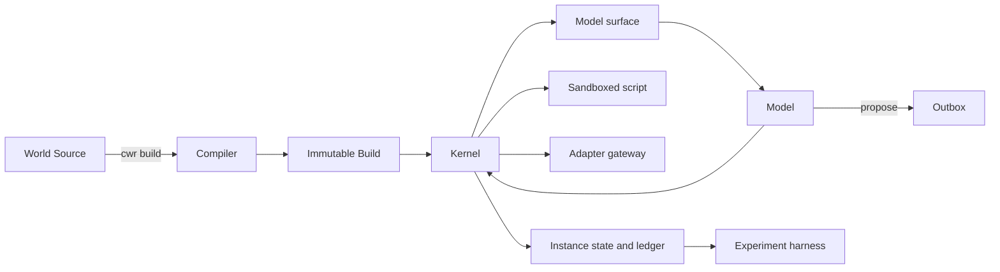

<!-- Copyright Sidiora Labs Inc. CWR® 2026-2027 -->
<!-- SPDX-License-Identifier: LicenseRef-Sidiora-DEV-OSS-1.0 -->

# Compiled World Runtime design

Status: design draft. The [specification](spec.kvx) is normative; all verification is UNRUN.

## 1. The analogy and the claim

An ordinary agent harness is a body: a set of tools the model reaches for, whose shapes, availability and failure modes can change between calls and between deployments. The model spends context re-deriving what the body can do. A Compiled World Runtime is a world: a fixed set of rules the model lives inside. A chair is a chair on every turn; sitting on it has the same outcome under the same visible conditions, and if it is occupied the world says so before the model sits.

The claim is not that a world is more capable than a body. It is that a model acting inside stable, visible, directly scriptable rules will fail less, repeat failures less, reuse rules more and keep acting correctly over long horizons and across announced change. Each of those is a hypothesis in [experiments.md](experiments.md), tested only against CWR Builds with one pillar removed.

## 2. Layers and responsibility boundaries

| Layer | Owns | Does not establish |
|---|---|---|
| World Source | Human-edited rules: contracts, adapters, library, migrations, manual prose, changelog | Any running behaviour; a source file is not a Build |
| World Compiler | Parsing, lints, contract tests, diff, changelog gate, generation, packaging into an immutable Build | Instance state; the compiler never touches a running world |
| Build | The frozen world: contracts.json, manual, SDK, library, adapters, fixtures, migrations, hash | Which Instances exist or what they have done |
| World Kernel | Instances, sandboxed turns, atomic primitives, adapter gateway, clock, RNG, ledger, snapshots, upgrade | New rules; the kernel has no write path into a Build |
| Model surface | Context composition and the turn protocol | Anything outside manual, notice, ledger tail, history and envelope |
| Proposal outbox | A text record outside the world | Any effect inside the world |
| Experiment harness | Arms, seeds, metrics, analysis, read from ledgers | Any influence on a running Instance |
| Human owner | Editing source, recompiling, upgrading Instances, reading proposals | Correctness by assertion; every rule is tested by the compiler |

The [architecture diagram](diagrams/architecture.mmd) shows the same boundaries as a flow.

## 3. Governing invariants

1. **Closure.** A Build enumerates every primitive, adapter, limit and failure code. Nothing else is callable from inside an Instance: no host filesystem, network, clock, process or random source.
2. **Visibility.** Every precondition is an expression over read_only primitives and parameters. The model can query every condition before acting, and the first failing precondition names its failure code, the primitive and its index.
3. **Interface determinism.** Equal parameters under equal visible conditions give equal outcomes, where outcome is status, result shape and side-effect class. Payloads from adapters are content, not rules, and are never guaranteed.
4. **Predictable failure.** The failure envelope is closed at eleven codes. RATE_LIMITED carries retry_after in ticks. An undeclared code after passed preconditions is INVARIANT_VIOLATION and counts as a defect, never as an outcome.
5. **Human-only change.** Only `cwr build` creates a Build. Only `cwr instance upgrade`, run by a human, moves an Instance to another Build, and the model sees a recompile notice derived from the changelog on its next turn.
6. **One Build, many Instances.** Instance state, snapshots and the ledger live outside the Build. The Build is read-only and verified by hash on every load.
7. **Primitives are atomic; scripts are not.** A failure before execute leaves state unchanged. A script that fails after a successful mutation reports partial with the full trace instead of rolling back.
8. **World time is ticks.** The clock advances by tick_per_primitive and tick_per_turn only. Adapter timeouts are measured in host time but reported into world time as declared ticks.
9. **The ledger is complete.** Every primitive call, turn, drift injection, proposal, upgrade and recovery is a ledger record written before the result returns. Replay from seed, initial state, Build and cassettes reproduces the ledger except host fields.
10. **The outbox has no effect.** Proposals are text. Nothing in the kernel reads the outbox.
11. **No external baseline.** Every experimental arm is a CWR Build with exactly one pillar ablated by an experimental flag; nothing compares to any other agent or harness.

## 4. The compiled world

A World Source is a directory of KVX files and Python library code described in [world-source.md](world-source.md). The compiler described in [compiler.md](compiler.md) parses and resolves it, lints for closure and visibility, runs contract tests in an ephemeral Instance, diffs against the previous Build, applies the changelog gate, generates the manual and the SDK from the same compiled contracts, and packages a read-only directory keyed by sha256. The manual and the enforced rule cannot diverge because both are rendered from `contracts.json`.

An experimental Build is produced from the same source with one flag and lives under `xbuild/`. Its ContractDiff against the control Build lists only what the flag changes. The kernel refuses to load it without `--allow-experimental` and stamps the flag into every ledger record, so an ablation can never be mistaken for a control run.

## 5. One turn from context to ledger

The [turn diagram](diagrams/turn.mmd) shows the sequence; [kernel.md](kernel.md) and [model-surface.md](model-surface.md) give the contracts.

1. The kernel composes the context: the Build's manual, byte-identical on every turn; the recompile notice if an upgrade just happened; the last K ledger records as one line each; the last result envelope.
2. The model returns exactly one fenced Python block. Zero or more than one block is INVALID; nothing executes and the clock does not tick.
3. The kernel starts a fresh sandboxed Python 3.12 process with only the Build SDK importable, no network, no host filesystem and no host clock, under cpu_ms, wall_ms and memory_mb.
4. Each SDK call is one RPC. The kernel validates parameters, evaluates preconditions in declared order, executes against state or through the adapter gateway, asserts effects in debug mode, advances world_time by one tick and appends the ledger record durably before returning the result or raising the typed exception.
5. The script ends with ok, error or partial. The kernel advances world_time by the turn tick, appends the turn record and renders the result envelope with status, returned value, error, trace, world coordinates and resource use.
6. The harness, if any, reads the ledger. It never touches the Instance.

## 6. One upgrade from source edit to notice

1. A human edits the World Source and updates CHANGELOG.kvx with a release whose changes cover every intended rule change, naming a migration for every state-shape change.
2. `cwr build` runs the pipeline. The changelog gate refuses the Build if the ContractDiff has an uncovered entry or the declared version is below the derived bump. On success a new read-only Build appears with its own hash.
3. `cwr instance upgrade` verifies the target hash, refuses a different world name or a non-increasing version, snapshots the Instance, applies the migrations in order as pure state functions, commits and records the recompile notice. Any failure rolls back to the prior snapshot and Build with nothing partial visible.
4. On the next turn the model sees the notice: old and new versions, the human summary and every contract change touching a primitive this Instance has already used. Only an experimental silent-change or version-only Build alters that rendering, and that is exactly what hypothesis H4 measures.
5. The model may call `world.propose` to send text upward. The owner reads the outbox outside the world; the proposal changes nothing by itself.

## 7. Reference world and experiments

[reference-world.md](reference-world.md) defines refworld: fs, kv, jobs, search, publish and world modules with locks, size limits, quotas, job state transitions, rate limits and idempotency keys, two adapters over stub servers with recorded cassettes, 60 tasks in three length bins with pure success predicates, and six upgrade pairs. [experiments.md](experiments.md) defines the arms for H1 to H4, the ledger-only metrics, 10 seeds per task, replay mode and pre-registration.

## 8. Failure and recovery

A kernel crash is recovered from the last snapshot plus the ledger prefix. The interrupted turn is recorded as error with UNAVAILABLE. An external primitive with an existing ledger record is marked complete rather than re-executed, so a stub server sees each request once. A failed upgrade rolls back entirely. The adapter gateway never retries; retry is the model's decision, informed by RATE_LIMITED retry_after and the manual. These rules are stated in [kernel.md](kernel.md) and exercised by cases CWR-009 to CWR-011 in [verification.md](verification.md).

## 9. What this design does not claim

It does not claim a world is faster, cheaper or more capable than any other arrangement. It does not claim that payloads from external services are stable. It does not claim that a model will read the manual. Each hypothesis has a pre-registered direction and a complete arm matrix, and a result exists only when the ledgers exist. No implementation status is inferred from this document.
